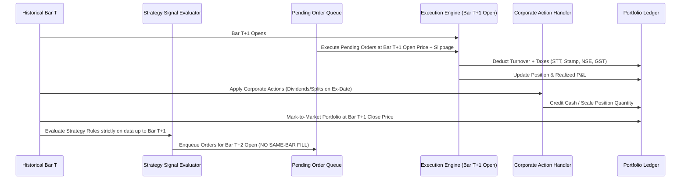

# AURXON Deterministic Backtesting Engine Specification
**Project:** AURXONQuant  
**Milestone:** Phase 3, Stage 1 — Deterministic Backtesting Engine  
**Status:** SPECIFIED & IMPLEMENTED  
**Date:** 2026-10-13  

---

## 1. Engine Architecture & Event Chronology

The AURXON Backtesting Engine operates on an **event-driven, zero-lookahead chronological loop**:

### 1.1 Prevention of Lookahead Leakage
- **Signal Generation:** Strategy receives history slice strictly up to the current bar (`bars[:i+1]`). Future bars (`bars[i+1:]`) are inaccessible.
- **Execution Timing:** An order generated at Bar $T$ Close is queued for execution at **Bar $T+1$ Open**.
- **No Same-Bar Execution:** Fills cannot occur at the same bar's close where the signal was generated. Same-bar leakage is mathematically impossible in this architecture.

---

## 2. Indian Statutory Transaction Cost Model

The cost engine (`IndianTransactionCostModel`) implements statutory Indian tax schedules based on official Finance Acts and exchange circulars:

| Tax / Charge Component | Delivery Rate | Intraday Rate | Regulatory Authority & Legal Citation |
| :--- | :--- | :--- | :--- |
| **Securities Transaction Tax (STT)** | 0.1% on Buy & 0.1% on Sell turnover | 0.025% on Sell turnover only | Finance Act 2004, Chapter VII; Schedule II |
| **Indian Stamp Duty** | 0.015% on Buy turnover only | 0.003% on Buy turnover only | Indian Stamp Act 1899 (as amended July 1, 2020) |
| **NSE Transaction Charges** | 0.00297% on turnover | 0.00297% on turnover | NSE Circular NCL/CMPT/48753 |
| **SEBI Turnover Fee** | 0.0001% (₹10 per crore) | 0.0001% (₹10 per crore) | SEBI (Stock Brokers) Regulations, Schedule III |
| **Goods & Services Tax (GST)** | 18% on (Brokerage + NSE Txn + SEBI Fee) | 18% on (Brokerage + NSE Txn + SEBI Fee) | Central Goods and Services Tax Act 2017 |
| **Execution Slippage** | 5.0 bps default (0.05%) | 5.0 bps default | Configurable bid-ask spread and market impact |

### Cash Flow Impact Formula
- **For BUY:** $\text{Cash Deducted} = \text{Turnover} + \text{Total Charges}$
- **For SELL:** $\text{Cash Received} = \max(0, \text{Turnover} - \text{Total Charges})$

---

## 3. Corporate Action Accounting

Corporate actions take effect at the start of the Ex-Date:
1. **Cash Dividend:**
   $$\text{Cash Balance}_{new} = \text{Cash Balance}_{old} + (\text{Held Quantity} \times \text{Dividend per Share})$$
2. **Stock Split / Bonus Issue:**
   $$\text{Held Quantity}_{new} = \lfloor \text{Held Quantity}_{old} \times \frac{\text{Numerator}}{\text{Denominator}} \rfloor$$
   $$\text{Average Cost}_{new} = \text{Average Cost}_{old} \times \frac{\text{Denominator}}{\text{Numerator}}$$
   Open FIFO purchase lots are adjusted proportionally, preserving exact economic cost basis.

---

## 4. Cryptographic Audit Chain Integration

Upon completion of each simulation:
1. Engine serializes configuration, strategy version, parameter sets, date range, and performance metrics.
2. Generates a content SHA-256 hash.
3. Links to the latest block in SQLite WAL `audit_chain` using:
   $$\text{Chained Hash} = \text{SHA-256}(\text{Seq} : \text{PrevHash} : \text{ContentHash} : \text{Timestamp})$$
4. Returns the verifiable `audit_id` and `audit_chain_hash`.
