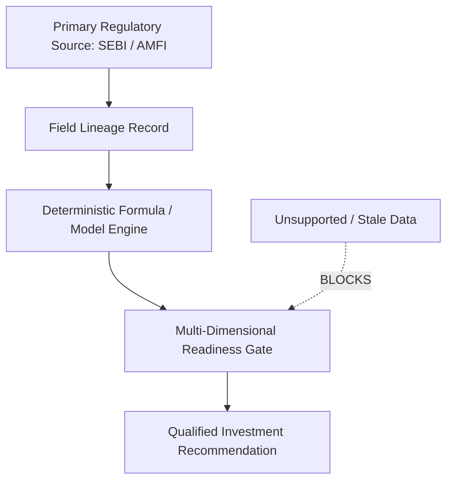

# AURXON Evidence Claim Lineage & Graph — Phase 2.2
**Project:** AURXONQuant  
**Milestone:** Phase 2.2 — Primary-Source Data Integration & Evidence Verification  
**Status:** ENFORCED  
**Date:** 2026-10-13  

---

## 1. Categorization of Claims

The AURXON Adaptive Evidence Intelligence Architecture (AEIA) separates claims into 6 unambiguous semantic categories:

1. `SOURCE_FACT`: Verbatim data directly extracted from a primary regulatory document or verified filing (e.g., "Fresh issue is ₹3,560 Cr in Bajaj Housing RHP page 81").
2. `CORROBORATED_FACT`: A fact independently verified by two or more unrelated primary sources (e.g., promoter shareholding confirmed by SEBI RHP and NSE corporate filing).
3. `DETERMINISTIC_CALCULATION`: An exact mathematical calculation derived without heuristics (e.g., `dilution = new_shares / post_shares * 100`).
4. `ANALYST_INTERPRETATION`: An analytical synthesis or thesis derived from corroborated facts (e.g., "Top 5 client concentration of 60.5% exposes Tata Technologies to OEM budget volatility").
5. `FORECAST_SCENARIO`: A sensitivity or stress scenario based on explicit stated assumptions (e.g., "-25% stress scenario in equity allocation"). Never presented as a guarantee.
6. `UNSUPPORTED_CLAIM`: A claim lacking verifiable source citations or conflicting with official filings. Flags an immediate blocker in recommendation readiness.

---

## 2. Lineage Integrity Model

Every material claim is bound to a lineage record containing:
- Issuer / Security Identifier
- Filing Name & Version
- Publication Date & Retrieval Timestamp
- Exact Page / Table / Section Number
- Original Disclosed Text
- Normalized Numerical Value & Units
- Extraction Method & Verification Status

---

## 3. Disagreement and Contradiction Handling

When two sources disagree (e.g. aggregator claims ₹7,000 Cr issue size while SEBI RHP specifies ₹6,560 Cr):
1. The discrepancy is retained and logged in `key_unresolved_facts`.
2. The primary regulatory source (SEBI RHP) is prioritized over secondary aggregators.
3. If an unresolved contradiction affects valuation multiples by >5%, the recommendation is downgraded to `QUALIFIED_ADVISORY` or `BLOCKED_DEFICIENT`.
