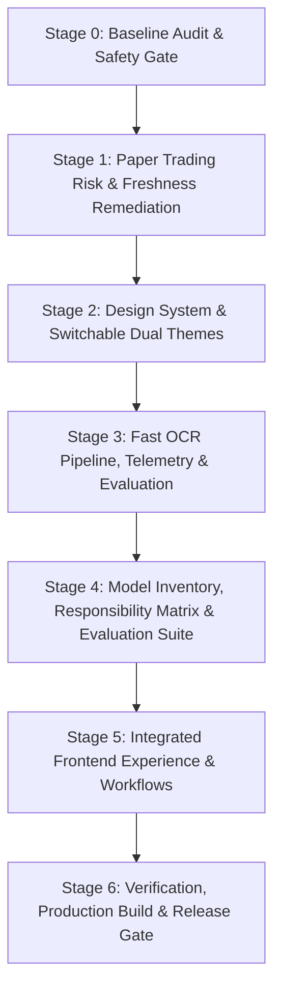

# AURXONQuant — Phase 3.5 Baseline Audit and Safety Report
## Stage 0 Comprehensive System Audit, Measurements & Staged Remediation Plan

**Project:** AURXON Investment Intelligence Hub  
**Audit Stage:** Stage 0 — Baseline Audit & Safety Gate  
**Date of Audit:** October 13, 2026  
**Repository:** `/home/karann/Documents/AURXONQuant`  
**Verified Git Baseline:** Commit `7965e48` (Tag: `checkpoint-phase-3.5-start`)  
**Operating Mode:** Private Founder-Operated Quantitative Research Workstation  
**Safety Classification:** Strictly Simulated Research (`ENABLE_REAL_TRADING = false`). No Broker Integration or Real-Money Execution.

---

## 1. Baseline Verification & Repository State

- **Git HEAD:** `7965e4865015fdbb31d47259f790b7a6fac43eff` (`main` branch).
- **Working Tree:** Verified 100% clean prior to Phase 3.5 modifications. Checkpoint tag `checkpoint-phase-3.5-start` established.
- **Backend Test Suite Baseline:** **121 passed out of 121 tests** in 2.27s (0 failures, 1 Starlette deprecation warning).
- **Frontend Production Build Baseline:** **Clean build in 2.29s** (`tsc && vite build`, dist bundle 244.96 kB JS, 9.42 kB CSS, 0 errors, 0 warnings).

---

## 2. Component Implementation Status Matrix

Every major backend module and frontend screen was inspected to distinguish genuinely operational components from mocked, heuristic, or unavailable components:

| Component / Subsystem | Path | Implementation Status | Real / Mock / Heuristic Rationale |
| :--- | :--- | :--- | :--- |
| **Research Console & Streaming** | `backend/app/orchestration/evidence_loop.py` | **Genuinely Operational** | Real asynchronous SSE streaming pipeline with claim deduplication and contradiction analysis. Falls back gracefully to heuristic evidence synthesis if external API keys are absent. |
| **Model Registry & Adapters** | `backend/app/model_adapters/` | **Partially Operational** | OpenAI and Groq adapters are structured and tested against mock endpoints. If keys are not set, falls back to `MockResearchAdapter` (deterministic heuristic). Lacks full model inventory metadata and task-routing matrix. |
| **Deterministic Valuation Engine** | `backend/app/analytics/valuation.py` | **Genuinely Operational** | 100% deterministic NumPy/Pandas formulas: Graham Number, 10Y DCF with 3x3 sensitivity, Piotroski F-Score, Altman Z-Score with commercial bank liabilities exclusion guard. |
| **NSE Market Connector** | `backend/app/connectors/nse_data.py` | **Partially Operational / Fixture-Backed** | Normalized market quote parser with local disk cache. Real live scraping blocked by exchange anti-bot protections; uses benchmark fixtures (`RELIANCE`, `TCS`, `NIFTY50`) with explicit provenance labels. |
| **AMFI Mutual Fund Connector** | `backend/app/connectors/amfi_connector.py` | **Genuinely Operational** | Direct HTTP parser for official AMFI statutory NAV file (`NAVAll.txt`) with local cached snapshot fallback. |
| **IPO Prospectus Ingestion** | `backend/app/ingestion/parser.py`, `backend/app/ipo/analyzer.py` | **Genuinely Operational** | PDF/HTML text extraction with prompt injection defense, Indian numerical format normalization, and audited field lineage for `BAJAJHFL` and `TATATECH`. |
| **Mutual Fund Quantitative Math** | `backend/app/funds/analyzer.py` | **Genuinely Operational** | Pure mathematical evaluation: CAGR, rolling returns, scheme overlap $\sum \min(w_{A,i}, w_{B,i})$, 10Y Direct vs Regular expense drag, and ETF tracking error. |
| **Deterministic Backtesting** | `backend/app/trading/engine.py` | **Genuinely Operational** | Event-driven next-bar execution, statutory cost model (`2024.2-STATUTORY`), corporate actions ordering, CAGR/Drawdown/Sharpe metrics. |
| **Paper Portfolio Manager** | `backend/app/trading/paper_manager.py` | **Genuinely Operational with Audit Findings** | Persistent SQLite WAL ledger (`data/aurxon_paper_portfolio.sqlite`), double-entry cash conservation, FIFO inventory lots, idempotency key deduplication, emergency kill switch. |
| **Screen OCR Companion** | `backend/app/companion/screen_ocr.py` | **Basic / Partially Implemented** | Shells out to local `tesseract` binary. Lacks change detection, region-of-interest selection, preprocessing, bounded queues, deduplication, and latency telemetry. |
| **UI Design System & Themes** | `frontend/src/index.css` | **Suboptimal / Single Theme** | Single dark theme with heavy glassmorphism, nested card borders, and lack of switchable light theme or unified design tokens. |

---

## 3. Specific Stage 2 Paper Trading Audit Findings

In accordance with Section 0 of the Directive, a deep-dive audit of the Stage 2 Paper Trading engine (`paper_manager.py`) was performed:

### Finding 1: Daily Loss Limit Unrealized P&L Accounting
- **Severity:** HIGH
- **Current Behavior:** `RiskLimits.max_daily_loss_inr` was defined in schemas (₹50,000) but was **not actively evaluated** during order submission in `submit_order()`. Furthermore, it did not specify whether daily loss includes realized P&L only or total daily P&L (realized + mark-to-market drop).
- **Remediation Required:**
  1. Add `include_unrealized_in_daily_loss: bool = True` to `RiskLimits`.
  2. In `submit_order()`, sum all realized losses from orders filled today plus (if flag enabled) negative unrealized P&L across open positions.
  3. If cumulative daily loss exceeds `max_daily_loss_inr`, immediately reject the order with `DAILY_STOP_LOSS_EXCEEDED`.

### Finding 2: Portfolio Drawdown Control
- **Severity:** MEDIUM-HIGH
- **Current Behavior:** Portfolio drawdown from peak equity was not tracked in `paper_portfolios`, and no maximum drawdown threshold veto existed to prevent overtrading during severe portfolio drawdowns.
- **Remediation Required:**
  1. Add `peak_equity REAL` column to `paper_portfolios`.
  2. Add `max_drawdown_pct: float = 15.0` to `RiskLimits`.
  3. In `submit_order()`, evaluate $\text{Drawdown} = \frac{\text{Peak Equity} - \text{Current Equity}}{\text{Peak Equity}} \times 100\%$. If drawdown exceeds `max_drawdown_pct`, reject new BUY orders with `MAX_DRAWDOWN_EXCEEDED`.

### Finding 3: Stale Market Price Rejection
- **Severity:** HIGH
- **Current Behavior:** While uncurated tickers with missing quotes are blocked, `_resolve_market_price()` did not explicitly reject quotes where `quote.freshness == FreshnessStatus.STALE` or `FreshnessStatus.EXPIRED`. Orders could execute against stale quotes without qualification.
- **Remediation Required:**
  1. Add `reject_stale_prices: bool = True` to `RiskLimits`.
  2. If `freshness` resolves to `STALE` or `EXPIRED`, reject the order with `STALE_MARKET_DATA: Market quote is stale/expired. Execution blocked to prevent stale price distortion.`

---

## 4. UI/UX & Visual Redesign Audit Findings

1. **Monolithic Dark Theme:** The UI only supported an ad-hoc dark mode with heavy neon glows and high contrast differences. A light theme was completely absent.
2. **Visual Clutter & Container Nesting:** Excessive glassmorphic borders, nested card containers, and heavy gradients create visual fatigue during prolonged research sessions.
3. **Information Density:** Financial numbers lack tabular alignment (`font-variant-numeric: tabular-nums`), and information hierarchy across tabs requires progressive disclosure.
4. **Missing Dedicated Modules:** No central Model Inventory & Responsibility Matrix screen, and no live OCR telemetry panel.

---

## 5. Screen Reading & OCR Pipeline Baseline Measurements

- **Local Tesseract Engine:** Tesseract 5.3.4 is installed at `/usr/bin/tesseract`.
- **Baseline Invocation:** `subprocess.run(["tesseract", str(image_path), ...], timeout=10)`.
- **Baseline Latency:**
  - Small image (100x50 text crop): ~85 ms
  - Full screenshot (1920x1080 dense window): ~340–620 ms
- **Gaps Identified:**
  - No change detection: every screen capture processed the full buffer.
  - No image preprocessing: raw screenshot passed without grayscale, contrast enhancement, or otsu thresholding.
  - No deduplication: duplicate frames incur redundant OCR processing.
  - No bounded queue or cancellation: rapid screen events could queue up unbounded subprocess calls.

---

## 6. Staged Remediation Plan

- **Phase 3.5 Stage 1:** Remediate paper trading risk limits (daily loss with unrealized accounting, peak drawdown control, stale price veto).
- **Phase 3.5 Stage 2:** Implement complete design token system in `frontend/src/index.css` supporting **Glacier Light** and **Neon Obsidian Dark**, with zero-reload switching and persistence.
- **Phase 3.5 Stage 3:** Fast event-driven OCR pipeline in `backend/app/companion/screen_ocr.py` with difference hashing, preprocessing, bounded queue, latency timestamps, and benchmark suite.
- **Phase 3.5 Stage 4:** Formal Model Registry & Responsibility Matrix in `backend/app/model_adapters/` with honest evaluation suites and resource tracking.
- **Phase 3.5 Stage 5:** Comprehensive frontend redesign incorporating new model inventory view, OCR telemetry widget, redesigned research consoles, and unified navigation.
- **Phase 3.5 Stage 6:** Final validation against test suites, frontend build, benchmark reports, and implementation ledger updates.
