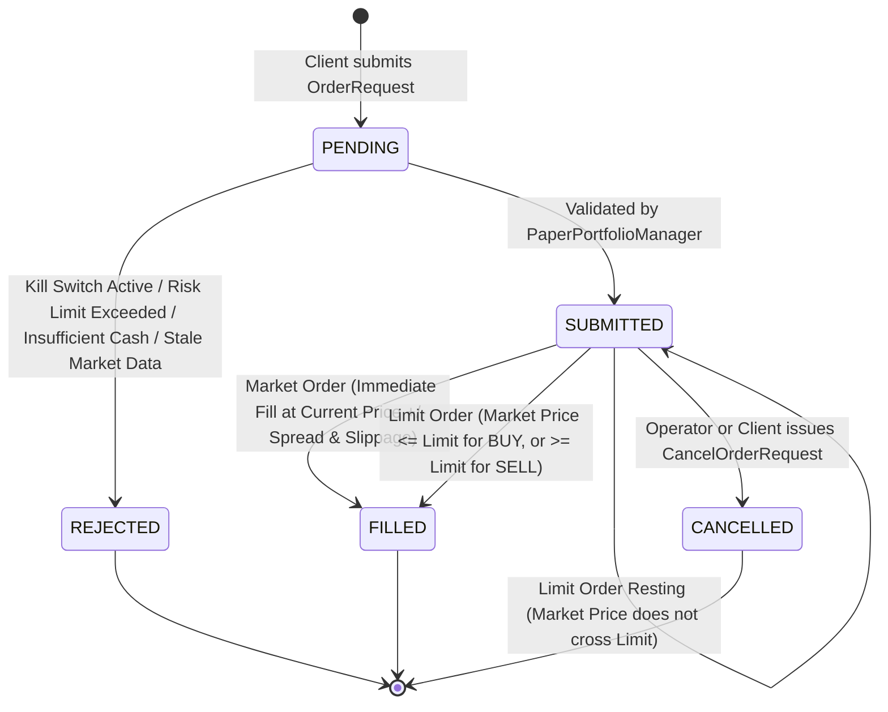

# AURXONQuant — Phase 3, Stage 2 Specification
## Paper Trading Portfolio Manager & Execution Ledger

**Project:** AURXON Investment Intelligence Hub  
**Milestone:** Phase 3, Stage 2 — Paper Trading Portfolio Manager  
**Date:** October 13, 2026  
**Status:** IMPLEMENTED & VERIFIED  
**Safety Classification:** Strictly Simulated Paper Portfolio (`ENABLE_REAL_TRADING = false`). No Broker Integration or Real-Money Execution.

---

## 1. Architectural Mission & Objectives

The Paper Trading Portfolio Manager provides a high-fidelity, deterministic, and auditable simulated trading workstation for Indian market research. It bridges research strategy outputs with realistic order execution mechanics without exposing the operator to broker APIs or capital loss.

### Core Objectives:
1. **Persistent Virtual Cash & Equity Ledger:** SQLite WAL-backed double-entry balance accounting that enforces cash conservation and survives application restarts.
2. **Order Lifecycle State Machine:** Full lifecycle simulation: `PENDING` $\to$ `SUBMITTED` $\to$ `FILLED` / `REJECTED` / `CANCELLED`, supporting Market and Limit orders.
3. **Inventory & Cost Basis Accounting:** Position tracking with weighted average price, FIFO lot allocation, realized P&L, unrealized mark-to-market P&L, and instrument-level portfolio exposure.
4. **Statutory Indian Costs & Slippage:** Direct application of official statutory rates (`2024.2-STATUTORY` schedule: STT, Stamp Duty, NSE transaction charges, SEBI turnover fees, GST) plus configurable slippage and bid-ask spreads.
5. **Duplicate-Event Protection & Idempotency:** Client-supplied idempotency keys preventing accidental double-order submissions across network retries or replay storms.
6. **Immutable Audit Chaining:** Complete audit logging of all state-changing events (orders, fills, cancellations, rejections, corporate actions, kill switch activations) into SQLite and sequential SHA-256 hash chains.
7. **Independent Risk Limits & Kill Switch:** Hard pre-execution risk checks (maximum order value, maximum position weight, daily stop-loss) and an emergency kill switch toggle that halts new orders immediately.
8. **Explicit Provenance & Freshness Guard:** Mandatory data classification and freshness metadata on all price quotes. Uncurated instruments without verified price feeds trigger explicit order rejection rather than synthetic price fabrication.

---

## 2. Order Lifecycle & Execution State Machine

### State Transitions:
- **`PENDING`:** Initial transient state when an order is received.
- **`SUBMITTED`:** Order has passed preliminary pre-flight validation (risk limits, operator kill switch, syntax check).
- **`FILLED`:** The order executed successfully. Cash is debited (for buy) or credited (for sell, net of statutory taxes). Positions and FIFO lots are updated.
- **`REJECTED`:** Pre-execution checks failed. Cash balance and positions remain untouched. The rejection reason is permanently recorded in the order log.
- **`CANCELLED`:** A resting limit order was cancelled prior to execution.

---

## 3. Financial & Accounting Mechanics

### 3.1 Cash Conservation Equation
For any portfolio state at time $t$:
$$\text{Total Equity}_t = \text{Virtual Cash}_t + \sum_{i=1}^{N} \left( Q_{i,t} \times P_{i,t} \right)$$
Where:
- $Q_{i,t}$ is the quantity held of instrument $i$.
- $P_{i,t}$ is the current mark-to-market market price of instrument $i$.

### 3.2 Buy Order Execution
$$\text{Execution Price} = P_{\text{market}} \times (1 + \text{Slippage Pct}) + \frac{\text{Spread}}{2}$$
$$\text{Turnover} = Q \times \text{Execution Price}$$
$$\text{Statutory Costs} = \text{CostModel}(Q, \text{Execution Price}, \text{BUY})$$
$$\text{Total Cash Deducted} = \text{Turnover} + \text{Statutory Costs}$$

Cash deduction requires $\text{Virtual Cash} \ge \text{Total Cash Deducted}$; otherwise the order transitions immediately to `REJECTED`.

### 3.3 Sell Order Execution & Realized P&L
$$\text{Execution Price} = P_{\text{market}} \times (1 - \text{Slippage Pct}) - \frac{\text{Spread}}{2}$$
$$\text{Turnover} = Q \times \text{Execution Price}$$
$$\text{Statutory Costs} = \text{CostModel}(Q, \text{Execution Price}, \text{SELL})$$
$$\text{Net Cash Credited} = \text{Turnover} - \text{Statutory Costs}$$

Realized P&L is determined by FIFO lot consumption:
$$\text{Realized P&L} = \sum_{\text{lots}} q_{\text{lot}} \times (\text{Execution Price} - p_{\text{lot}}) - \text{Statutory Costs}$$

### 3.4 Corporate Actions Handling
1. **Cash Dividend:** Credited to virtual cash without changing share counts:
   $$\text{Virtual Cash}_{t+1} = \text{Virtual Cash}_t + (Q \times \text{Dividend Per Share})$$
2. **Stock Split / Bonus:** Adjusts share counts and inversely adjusts average cost while leaving cash untouched:
   $$Q_{t+1} = Q_t \times \text{Multiplier}$$
   $$\text{Avg Cost}_{t+1} = \frac{\text{Avg Cost}_t}{\text{Multiplier}}$$
   All active FIFO lot quantities are scaled and lot prices divided by the multiplier.

---

## 4. Risk Limits Engine & Operator Kill Switch

Risk checks execute synchronously in `PaperPortfolioManager` before order registration:

| Limit Parameter | Default Setting | Action on Violation |
| :--- | :--- | :--- |
| **Kill Switch** | `ACTIVE / DISENGAGED` (Manual toggle) | If ENGAGED (`kill_switch_active = True`), all new orders are **REJECTED** with `KILL_SWITCH_ENGAGED`. Existing positions remain intact. |
| **Max Order Value** | ₹5,00,000 | Orders exceeding maximum gross value are **REJECTED** with `MAX_ORDER_VALUE_EXCEEDED`. |
| **Max Position Weight** | 30.0% of Total Portfolio Equity | Orders increasing an instrument's portfolio weight beyond the cap are **REJECTED** with `MAX_POSITION_WEIGHT_EXCEEDED`. |
| **Max Daily Loss** | ₹50,000 | If cumulative realized loss exceeds the daily loss threshold, new orders are **REJECTED** with `DAILY_STOP_LOSS_EXCEEDED`. |
| **Stale Market Data** | Verified Freshness Window | Stale or missing market quotes block execution with `STALE_MARKET_DATA` or `MARKET_DATA_UNAVAILABLE`. |

---

## 5. Persistence, Restart Recovery & Idempotency

### 5.1 SQLite WAL Database (`aurxon_paper_portfolio.sqlite`)
The portfolio manager persists state across process restarts across three tables:
1. `paper_portfolio_meta`: Key-value storage for portfolio metadata, initial cash, current cash, realized P&L, and kill switch status.
2. `paper_positions`: Current open positions, share quantities, weighted average cost, and JSON-serialized FIFO lots.
3. `paper_orders`: Complete historical record of all simulated orders (pending, filled, cancelled, rejected) indexed by `idempotency_key UNIQUE`.

### 5.2 Idempotency Protection
- Every order submission accepts an `idempotency_key` (UUID or client token).
- If an order with the same `idempotency_key` already exists, `PaperPortfolioManager` returns the existing record immediately without debiting cash or altering positions.

### 5.3 Cryptographic Audit Trail
All state-modifying actions are recorded into the AURXON SHA-256 sequential hash chain (`audit_chain` in `audit_ledger.sqlite`), linking the paper trading ledger directly to the institutional evidence trail.

---

## 6. REST API Specification

| Endpoint | Method | Payload / Params | Response | Description |
| :--- | :--- | :--- | :--- | :--- |
| `/api/v1/paper/portfolio` | `GET` | None | `PaperPortfolioState` | Retrieves current virtual cash, equity, open positions, P&L, risk limits, and kill switch status. |
| `/api/v1/paper/order` | `POST` | `PaperOrderRequest` | `PaperOrderRecord` | Submits a new simulated order (Market or Limit) with statutory cost calculation and execution. |
| `/api/v1/paper/order/cancel` | `POST` | `CancelOrderRequest` | `PaperOrderRecord` | Cancels a resting submitted order. |
| `/api/v1/paper/orders` | `GET` | `symbol?: string`, `limit?: int` | `List[PaperOrderRecord]` | Fetches chronological order execution and audit history. |
| `/api/v1/paper/kill-switch` | `POST` | `KillSwitchRequest` | `PaperPortfolioState` | Toggles emergency execution kill switch state. |
| `/api/v1/paper/corporate-action`| `POST` | `PaperCorporateActionRequest` | `PaperPortfolioState` | Applies dividend, split, or bonus corporate actions to open positions. |
| `/api/v1/paper/reset` | `POST` | None | `PaperPortfolioState` | Resets virtual portfolio to initial cash (₹10,00,000) for testing/clean replay. |

---

## 7. Frontend User Experience & Safety Signage

The `PaperTradingView` React component features:
1. **Visible Simulation Banner:** Prominent amber alert banner: `⚠️ PAPER TRADING ONLY — SIMULATION ENVIRONMENT — REAL ORDERS LOCKED`.
2. **Emergency Operator Kill Switch:** Red/green interactive toggle controlling the simulated order gateway in real time.
3. **Execution Simulator Form:** Symbol, Side (BUY/SELL), Quantity, Order Type (MARKET/LIMIT), Limit Price, and optional Client Idempotency Key.
4. **Corporate Actions Simulation Modal:** Enables on-demand dividend, split, and bonus adjustments with immediate lot recomputation.
5. **Positions Table:** Live quantity, average cost, current price, unrealized P&L, and portfolio weight metrics.
6. **Audit Trail Table:** Chronological order log displaying timestamp, order ID, side, quantity, status (FILLED, REJECTED, CANCELLED), execution price, total statutory fees, and rejection reasons.
