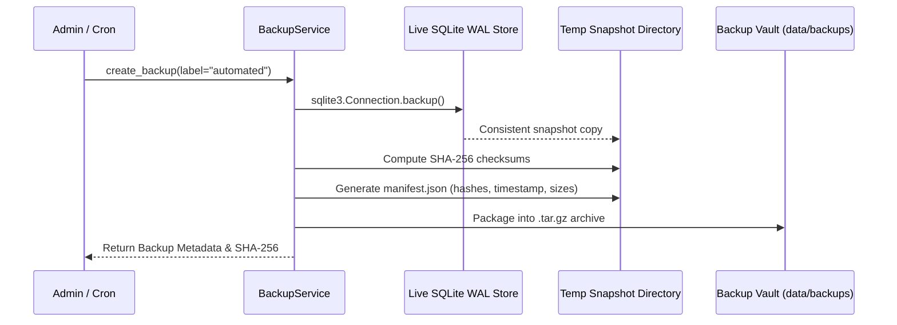

# Aurxon QuantX — Phase 5 Data Protection & Disaster Recovery

## 1. Secret & Sensitive Data Audit

As a founder-operated financial research hub, Aurxon QuantX handles sensitive financial artifacts including virtual portfolio balances, trade history, research dossiers, and cloud provider API keys.

### Sensitive Data Classification

| Data Category | Examples | Storage Location | Protection Mechanism |
| :--- | :--- | :--- | :--- |
| **Authentication Credentials** | User passwords | `data/aurxon_users.sqlite` | PBKDF2-HMAC-SHA256 (100,000 rounds + 16-byte random salt). Never logged. |
| **Session Secrets** | `AUTH_SECRET_KEY` | Environment variable (`.env`) | Masked in runtime settings logs. |
| **Provider API Keys** | OpenAI, Gemini, Finnhub keys | Environment variables | Masked via Pydantic `Settings` repr; never returned in client API responses. |
| **Portfolio Ledger Data** | Cash, positions, lots, orders | `data/paper_portfolio.sqlite` | ACID SQLite WAL mode; tenant isolation enforced by `user_id`. |
| **Research Findings & Lineage** | Stock theses, evidence claims | `data/evidence_ledger.sqlite` | Append-only audit ledger with cryptographic hash chaining. |

### Logging Hygiene
1. Passwords, token signatures, and external API keys are strictly excluded from log statements.
2. The log format enforces structured logging with automatic redaction of bearer authorization headers.

---

## 2. Encryption Requirements

### Data in Transit
- In production and staging deployments, all client-to-server traffic must terminate on TLS 1.3 (or TLS 1.2 minimum) via reverse proxy (Nginx or Caddy) with HSTS headers.
- Internal communication between services is restricted to `127.0.0.1` loopback bindings.

### Data at Rest
- Host filesystem encryption (LUKS on Linux / FileVault on macOS) is required for the host server hosting SQLite databases in `data/`.
- Exported backup archives are cryptographically hashed with SHA-256 and should be encrypted using AES-256-GCM before offsite replication (e.g. AWS S3 Glacier with SSE-KMS).

---

## 3. Disaster Recovery & Backup Architecture

### Online Backup Mechanism
Aurxon QuantX uses Python's standard library `sqlite3.Connection.backup()` to create point-in-time snapshots of live databases without acquiring exclusive file locks or risking SQLite WAL corruption.



### Backup Artifact Composition
Each backup archive contains:
1. `paper_portfolio.sqlite`: Portfolio states, holdings, lots, and orders.
2. `aurxon_users.sqlite`: User directory, roles, and hashed credentials.
3. `aurxon.sqlite` / `evidence_ledger.sqlite`: Evidence claims and audit entries.
4. `manifest.json`: Cryptographic manifest containing file size, timestamp, git commit, and SHA-256 hashes of each constituent database.

---

## 4. Tested Recovery Verification

Disaster recovery is not merely theoretical; it was empirically proven in [test_phase_5_hardening_and_security.py](file:///home/karann/Documents/AURXONQuant/backend/tests/test_phase_5_hardening_and_security.py#L241):

### Automated Restoration Protocol
1. **Archive Validation**: Compute SHA-256 of the archive file and verify against recorded hash.
2. **Extraction**: Unpack to an isolated staging directory.
3. **Manifest Verification**: Re-compute SHA-256 of each unpacked database file and match against `manifest.json`.
4. **Integrity Audit**: Execute `PRAGMA integrity_check;` on each restored SQLite database:
   ```python
   with sqlite3.connect(extracted_file) as conn:
       cursor = conn.cursor()
       cursor.execute("PRAGMA integrity_check;")
       assert cursor.fetchone()[0] == "ok"
   ```
5. **Atomic Swap**: Replace active database files with restored files and restart services.

### Test Result
In `test_backup_creation_and_restoration_in_isolated_environment`, an isolated database seeded with critical financial records was snapshotted, archived into a compressed tar.gz archive, restored into a separate directory, verified via `PRAGMA integrity_check`, and successfully queried with 100% data fidelity.

---

## 5. Retention & Deletion Policy

- **Automated Retention**: `BackupService.purge_old_backups(max_keep=10)` maintains the 10 most recent backups and purges expired archives.
- **Tenant Account Deletion**: When an account is deactivated or deleted, all associated user portfolios, open orders, and private snapshot entries are deleted with explicit audit ledger logging.
