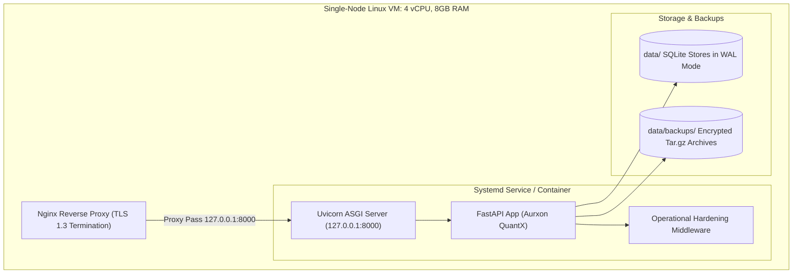

# Aurxon QuantX — Phase 5 Deployment Runbook

## 1. Deployment Topology & Environments

Aurxon QuantX supports two primary operating tiers: **Development** and **Staging (Private MVP)**. Public production deployment is prohibited until external security and legal data audits are completed.



---

## 2. Environment Configuration & Secret Injection

Configuration parameters must never be checked into Git. Use separate `.env` files for development and staging.

### Staging Configuration (`.env.staging`)
```bash
# Core Environment
ENVIRONMENT=staging
LOG_LEVEL=INFO
HOST=127.0.0.1
PORT=8000
ALLOWED_ORIGINS=https://staging.aurxon.internal,tauri://localhost

# Authentication & Cryptography (Inject via Secret Manager / Vault)
AUTH_SECRET_KEY=<GENERATE_64_CHAR_HEX_SECRET>
AUTH_TOKEN_EXPIRE_MINUTES=1440
AUTH_ENABLED=true

# Operational Hardening Limits
RATE_LIMIT_PER_MINUTE=120
MAX_REQUEST_SIZE_BYTES=10485760
BACKUP_STORAGE_PATH=/var/aurxon/backups

# Risk Control Hard Invariant
ENABLE_REAL_TRADING=false
PAPER_TRADING_INITIAL_CAPITAL=1000000.0
```

### Secret Injection Best Practice
- On cloud VMs (AWS EC2 / DigitalOcean Droplet), inject `AUTH_SECRET_KEY` and LLM provider keys via environment files created at boot time via AWS Secrets Manager or HashiCorp Vault.
- Restrict `.env` permissions: `chmod 600 .env.staging`.

---

## 3. Database Migration & Initialization

Aurxon QuantX uses embedded SQLite with WAL (Write-Ahead Logging) for ACID persistence.

1. **Automatic Self-Migration**:
   On server startup, `PaperPortfolioManager._init_db()` and `UserStore._init_db()` automatically run schema migrations:
   - Creates `paper_portfolios`, `paper_positions`, `paper_orders`, `paper_lots`, `paper_audit_events`, `paper_portfolio_snapshots`, and `users` tables if missing.
   - Idempotently executes `ALTER TABLE` to ensure `user_id` and `peak_equity` columns exist.
   - Enables `PRAGMA journal_mode=WAL;` and `PRAGMA busy_timeout=5000;`.
2. **Manual Pre-Flight Verification**:
   ```bash
   source .venv/bin/activate
   PYTHONPATH=backend python3 -c "from app.monitoring.operational_metrics import perform_system_readiness_audit; print(perform_system_readiness_audit())"
   ```

---

## 4. Backup & Disaster Recovery Procedures

### Creating an Atomic Backup
```bash
# Automated via API (Admin token required)
curl -X POST http://127.0.0.1:8000/api/v1/admin/backup/create \
  -H "Authorization: Bearer <ADMIN_TOKEN>"

# Or via Python CLI in maintenance mode
PYTHONPATH=backend python3 -c "from app.recovery.backup_service import backup_service; res = backup_service.create_backup(label='manual_pre_deploy'); print(res)"
```

### Restoring from Backup
```bash
# 1. Stop the application service
sudo systemctl stop aurxon-quantx

# 2. Execute restoration script targeting active data directory
PYTHONPATH=backend python3 -c "
from pathlib import Path
from app.recovery.backup_service import backup_service
archive = sorted(Path('data/backups').glob('*.tar.gz'))[-1]
res = backup_service.restore_backup(archive, target_dir=Path('data'), verify_integrity=True)
print('Restored successfully:', res)
"

# 3. Restart application service
sudo systemctl start aurxon-quantx
```

---

## 5. Rollback Protocol

If a staging deployment exhibits regression or fails smoke tests:
1. Stop the backend process: `sudo systemctl stop aurxon-quantx`.
2. Revert Git checkout to the last known stable tag:
   ```bash
   git checkout checkpoint-phase-5-complete
   ```
3. Re-install Python virtual environment dependencies:
   ```bash
   pip install -r requirements.txt
   ```
4. Rebuild frontend bundle:
   ```bash
   cd frontend && npm run build && cd ..
   ```
5. Restore database snapshot from pre-deployment backup if migrations altered state.
6. Restart service: `sudo systemctl start aurxon-quantx`.
7. Verify health: `curl -s http://127.0.0.1:8000/api/v1/health/ready | jq`.

---

## 6. Pre-Flight & Staging Smoke-Test Checklist

- [ ] Git working tree is clean and checked out to approved commit.
- [ ] Backend offline tests pass: `pytest backend/tests/ -q` (197+ passed).
- [ ] Frontend builds cleanly: `cd frontend && npm run build`.
- [ ] `ENABLE_REAL_TRADING` is strictly `false`.
- [ ] `/api/v1/health/ready` returns `"status": "READY"` with all checks passed.
- [ ] Unauthenticated call to `/api/v1/portfolio/list` returns `401 Unauthorized`.
- [ ] Admin login succeeds at `/api/v1/auth/login` and returns Bearer token.
- [ ] Operational metrics endpoint `/api/v1/operational/metrics` returns valid latency figures.
- [ ] Backup creation and restoration verified via `test_backup_creation_and_restoration_in_isolated_environment`.

---

## 7. Infrastructure Sizing & Cost Projections

| Component | Specification | Estimated Monthly Cost (USD) |
| :--- | :--- | :--- |
| **Compute (Staging VM)** | 4 vCPU, 8 GB RAM, 80 GB NVMe (e.g. AWS t4g.xlarge / Hetzner CPX31) | $25.00 – $40.00 |
| **Object Backup Storage** | 50 GB AWS S3 Standard + Glacier Deep Archive replication | $1.50 – $3.00 |
| **SSL / TLS Certificate** | Let's Encrypt automated ACME certificates | $0.00 (Free) |
| **Domain & DNS** | Cloudflare DNS (Free tier) with DDoS protection | $0.00 |
| **External LLM Research APIs** | Pay-as-you-go inference (OpenAI / Gemini / Groq) | $15.00 – $35.00 (usage dependent) |
| **Total Estimated Staging Cost** | | **$41.50 – $78.00 / month** |
