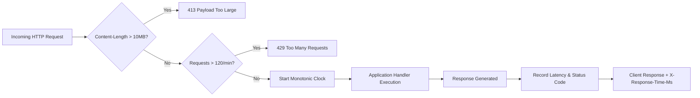

# Aurxon QuantX — Phase 5 Operations & Resilience Monitoring

## 1. Operational Hardening Overview

In Phase 5, **Aurxon QuantX** adds runtime observability, bounded latency tracking, rate limiting, and defensive error containment to ensure that unexpected external provider dropouts or payload surges never compromise system stability or corrupt quantitative research conclusions.

---

## 2. Telemetry & Metrics Architecture

All request executions are measured through `OperationalHardeningMiddleware` ([operational_metrics.py](file:///home/karann/Documents/AURXONQuant/backend/app/monitoring/operational_metrics.py)), which injects `X-Response-Time-Ms` into HTTP response headers and aggregates rolling metrics.



### Metrics Gathered
The in-memory metrics collector tracks:
1. **Uptime & Throughput**: Started timestamp, uptime seconds, total requests, and requests-per-second.
2. **Latency Distribution**: Rolling window of 1,000 requests calculating average, p50 (median), p95, and p99 response times in milliseconds.
3. **HTTP Status Code Breakdown**: Complete counter breakdown of 2xx, 4xx, and 5xx responses.
4. **Resilience Counters**:
   - `provider_failures_total`: Total count of network or parsing errors from external market connectors.
   - `provider_failures_by_source`: Failure breakdown by provider name (e.g., `yfinance`, `AMFI`, `AlphaVantage`).
   - `stale_data_alerts`: Number of times stale or unverified quotes were flagged.
   - `rate_limit_hits`: Requests blocked due to rate throttling.
   - `payload_size_violations`: Requests blocked due to excessive payload size.

---

## 3. Endpoints & Operational Interfaces

### System Readiness Audit (`GET /api/v1/health/ready`)
Designed for staging load-balancer health probes and pre-deployment smoke testing. Performs 4 live system checks:
- **Real-Money Safety**: Verifies `ENABLE_REAL_TRADING == False`.
- **User Store Database**: Verifies SQLite connection and queries user directory.
- **Paper Portfolio Database**: Verifies table schemas and active portfolio count.
- **Filesystem Permissions**: Confirms read/write access to `data/` and backup directory.

**Sample Response**:
```json
{
  "status": "READY",
  "product": "Aurxon QuantX",
  "timestamp": "2026-10-13T15:53:20.672105+00:00",
  "environment": "staging",
  "auth_enforced": true,
  "checks": {
    "real_trading_safety": "PASS — Real-money execution strictly disabled",
    "user_store_sqlite": "PASS — Accessible (5 configured users)",
    "paper_portfolio_sqlite": "PASS — Accessible (3 portfolios)",
    "storage_filesystem": "PASS — Read/Write permissions verified"
  }
}
```

### Operational Metrics (`GET /api/v1/operational/metrics`)
Requires authenticated access. Returns live operational metrics and latency percentiles.

---

## 4. Error Containment & Anti-Silent Failure

In quantitative equity research, a silent error (e.g. defaulting a missing price to 0 or inventing benchmark returns) is more dangerous than an explicit failure, as it can lead to false investment conclusions.

### Defensive Safeguards
1. **Explicit Unpriced Flags**: In `paper_manager.py`, unpriced securities are flagged as `UNPRICED` rather than falling back to zero.
2. **Missing Benchmark Transparency**: Factor models never fabricate beta when benchmark bars are deficient; they report explicit missing-data warnings.
3. **MWR Solver Bound Failures**: The IRR bisection solver in `portfolio_analytics.py` returns `None` with diagnostic reasons when brackets fail, preventing artificial return figures.
4. **Database Rollbacks**: All multi-lot rebalancing and order fill routines execute inside SQLite transactions; any failure rolls back state completely.
