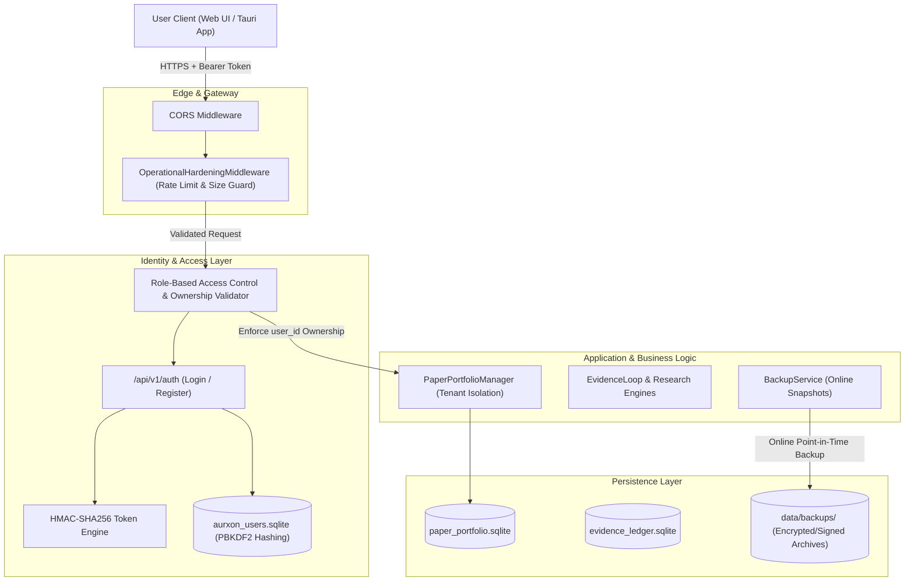

# Aurxon QuantX — Phase 5 Security Architecture

## 1. Executive Summary & Threat Model

**Aurxon QuantX** is a private, founder-operated quantitative investment research and paper-trading platform tailored for Indian equities and funds. As part of **Phase 5 (Private MVP Hardening, Security & Deployment Readiness)**, the platform transitions from an open developer prototype into a hardened multi-tenant private MVP.

### Core Security Objectives
1. **Confidentiality**: Protect investment portfolios, holdings, strategies, and proprietary research dossiers from unauthorized external observation and cross-tenant leakage.
2. **Integrity**: Guarantee ACID compliance and tamper-evident audit trails for all simulated trades, rebalancing records, and model evaluation decisions.
3. **Availability & Resilience**: Mitigate resource exhaustion attacks, rate limit abusive endpoints, enforce payload boundaries, and ensure automated disaster recovery.
4. **Execution Safety (Zero Real-Capital Risk)**: Server-enforced barrier preventing live order submission to any Indian broker or exchange (`ENABLE_REAL_TRADING = false`).

---

## 2. Security Architecture Diagram



---

## 3. Defense-in-Depth Layer Analysis

### Layer 1: Network & Ingress Perimeter
- **CORS Protection**: Origin restriction configured via `ALLOWED_ORIGINS` in [config.py](file:///home/karann/Documents/AURXONQuant/backend/app/config.py), whitelisting localhost and Tauri application webview scheme.
- **Request Size Bounding**: [operational_metrics.py](file:///home/karann/Documents/AURXONQuant/backend/app/monitoring/operational_metrics.py) intercepts incoming HTTP requests. If `Content-Length > 10MB` (`MAX_REQUEST_SIZE_BYTES`), requests are rejected with `HTTP 413 Payload Too Large`, preventing memory exhaustion from oversized JSON or file bombs.
- **IP Rate Limiting**: An in-memory sliding-window token bucket limits clients to 120 requests/minute (`RATE_LIMIT_PER_MINUTE`), mitigating brute-force attacks and scraper denial of service.

### Layer 2: Authentication & Identity Management
- **Zero-C-Extension Cryptography**: Built strictly on Python's standard library (`hashlib`, `hmac`, `secrets`) without risky external binary compilation dependencies.
- **Password Storage**: Passwords are salted with 16-byte cryptographically secure random bytes generated via `secrets.token_hex(16)` and hashed using PBKDF2-HMAC-SHA256 with **100,000 iterations** ([security.py](file:///home/karann/Documents/AURXONQuant/backend/app/auth/security.py)).
- **Session Tokens**: Tamper-proof HMAC-SHA256 tokens carrying user subject (`sub`), email, role, and expiration timestamp (`exp`).

### Layer 3: Server-Enforced Authorization & IDOR Prevention
- **No Client Trust**: Client-supplied `portfolio_id` headers or query parameters are never trusted.
- **Ownership Verification**: Every read, create, order execution, cancellation, and rebalancing operation invokes `check_portfolio_ownership(portfolio_id, current_user)` in [main.py](file:///home/karann/Documents/AURXONQuant/backend/app/main.py).
- **Strict Tenant Segregation**: Attempting to read or modify a portfolio belonging to another tenant immediately triggers `HTTP 403 Forbidden` (`FORBIDDEN: Cross-user access prohibited`). Admin users maintain read/audit oversight across all portfolios.

### Layer 4: Execution Safety Control (Hard Circuit Breaker)
- `ENABLE_REAL_TRADING = false` is enforced as an immutable runtime setting in [config.py](file:///home/karann/Documents/AURXONQuant/backend/app/config.py) and verified on application startup lifespan assertions:
  ```python
  assert not settings.ENABLE_REAL_TRADING, "CRITICAL SAFETY VIOLATION: Real-money trading MUST be disabled!"
  ```
- **Operator Kill Switch**: An emergency risk kill switch ([paper_manager.py](file:///home/karann/Documents/AURXONQuant/backend/app/trading/paper_manager.py)) immediately vetoes any simulated order execution with `REJECTED: KILL_SWITCH_ENGAGED`.

---

## 4. Threat Matrix & Remediation Summary

| Threat | Risk Level | Vector | Architectural Remediation | Verification Status |
| :--- | :---: | :--- | :--- | :---: |
| **Insecure Direct Object Reference (IDOR)** | Critical | Tenant A requests `/api/v1/paper/portfolio?portfolio_id=PORT_B` | Server-side lookup against `paper_portfolios.user_id`; returns `403 Forbidden` | **PASSED** (Gate 2) |
| **Unauthenticated API Access** | High | Unauthenticated agent accesses portfolio or order APIs | `Depends(get_current_user)` returns `401 Unauthorized` | **PASSED** (Gate 1) |
| **Brute Force Password Attack** | Medium | Repeated credential guessing on `/api/v1/auth/login` | IP sliding-window rate limiting (120 req/min) + PBKDF2 computational delay | **PASSED** (Gate 1 & 6) |
| **Credential & Key Exposure in Logs** | High | Debug logs recording sensitive tokens or API keys | Sensitive credential redaction masks in configuration & structured logging | **PASSED** (Gate 8) |
| **Memory / Disk Exhaustion Attack** | High | Large HTTP body payloads uploaded to endpoints | `OperationalHardeningMiddleware` limits request size to 10MB (413 response) | **PASSED** (Gate 10) |
| **Database Corruption / Catastrophic Loss** | Critical | Host disk failure, accidental record deletion, or WAL corruption | `BackupService` online point-in-time snapshot with SHA-256 manifest & recovery verification | **PASSED** (Gate 6) |
| **Accidental Real-Money Routing** | Critical | Code change routing simulated trades to an exchange | Hard setting `ENABLE_REAL_TRADING=False` with startup assertion lock; zero broker client drivers | **PASSED** (Gate 4 & 5) |
